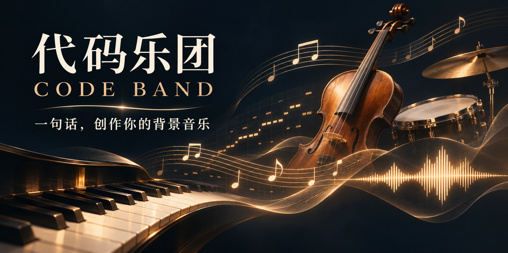

# 代码乐团 · Code Band

**中文** · [English](README.en.md)

[](LICENSE)  



> 让 Claude Code、Codex 给你写配乐：Agent 读需求、写乐谱，本地的真实乐器采样逐音演奏，交付**可编辑的乐谱工程**和 **WAV**。不调用生成式音频模型，不上传你的文件。

> **▶ 在线试听页**：<https://dososo.github.io/blcaptain-code-band/site/>：五段作品，覆盖中西合奏、管弦、钢琴和电子。

---

## 为什么做这个

生成式音乐模型能直接吐出一段音频，但你很难只改一处：鼓轻一点、缩短十秒、加一层弦乐、换个乐器，往往要整段重来，结果也不可复现。

代码乐团换了一条路：**让 Agent 当作曲和配器，用代码写谱，用真实采样演奏。** 每首作品都留下乐谱、冻结的演奏事件、随机种子和资产摘要，同一份谱重渲染逐样本一致；「保留旋律、只把鼓调轻」这类修改，可以逐事件证明别的声部没动。

> 诚实前提：代码乐团能写出结构完整、可编辑的配乐，但**不保证听感达到专业作曲水准**；「参考某首歌写同风格」目前还不是可靠能力（见下文「能力边界」）。

---

## 它能做什么

- **从一句中文写起**：「60 秒、温暖、城市夜行、无人声」，Agent 写主题、和声、配器和段落，渲染成 48 kHz / 24 位 WAV。
- **真实乐器**：默认 MuseScore General 音色库，加 60 个扩展采样包。主流管弦（VSCO 2 弦乐组、木管、铜管、定音鼓、竖琴）、钢琴、尼龙吉他，民族乐器有古琴、古筝、二胡、琵琶、笛子、箫、笙、京剧打击乐等，世界乐器另有一批。逐包许可见 [docs/third-party-soundfonts.md](docs/third-party-soundfonts.md)。
- **编排检查**：写谱前先写编排计划（谁唱主题、谁回答、哪里是唯一高峰），写完用 `arrange-check` 核对声部有没有撞起音、高峰是不是唯一、动机能不能被认出来。
- **定向修改**：调某个声部的音量、缩短、做无缝循环、加声部，每次修改都附谱面和事件的差异证明。
- **音频检查**：响度、真峰值、逐秒活动度、低频占比，交付前自动检查。
- **本地参考分析（可选）**：节拍、音符、分离和乐器家族候选。模型和权重需要你自行安装，结果只作候选，不当结论。

## 能力边界（请务必了解）

- **参考同风格创作没有通过验证。** 可以分析参考的速度、能量和层次，但「写得像某首歌」的结果，至今没有通过人工试听验收。
- **民族乐器不全。** 古琴、古筝、二胡有较完整的采样；唢呐、柳琴、三弦、中阮等在公开版中**没有可用音色**（候选素材的许可不满足开源要求），会如实报告缺失，不会拿别的乐器冒充。
- **流行乐器偏弱。** 电吉他、贝斯、合成器主要靠 GM 音色。
- **v1 不含插件合成器路径。** 开发版有一条接 Surge XT 合成器的路线，它依赖 GPL 组件，没有放进公开版。
- 只在 macOS（Apple Silicon）上完整测过；Linux 预计可用，待确认；Windows 没测。

---

## 安装

### 1. 准备环境

需要 Python 3.10 或更高版本、[FluidSynth](https://www.fluidsynth.org/) 和 [FFmpeg](https://ffmpeg.org/)。

```bash
brew install fluid-synth ffmpeg          # macOS
git clone https://github.com/dososo/blcaptain-code-band.git
cd blcaptain-code-band
python3 -m venv .venv
.venv/bin/python -m pip install -r skills/code-band-bgm/requirements.txt
```

### 2. 下载音色（约 3 GB）

音色文件不放在 git 仓库里，附在 Release 中，用脚本下载并逐个校验 SHA-256：

```bash
python3 scripts/fetch_soundfonts.py --list      # 先看清单和大小
python3 scripts/fetch_soundfonts.py             # 全部下载
python3 scripts/fetch_soundfonts.py --only MuseScore_General.sf3   # 只要默认音色（约 40 MB）
```

脚本只用 Python 标准库；先写临时文件，摘要对上才改名，已有且正确的文件会跳过。

### 3. 装进 Agent

| Agent | 安装 skill |
|---|---|
| Claude Code | `/plugin marketplace add dososo/blcaptain-code-band`，再 `/plugin install code-band@blcaptain-code-band` |
| Codex | `codex plugin marketplace add dososo/blcaptain-code-band`，再 `codex plugin add code-band@blcaptain-code-band` |

插件方式只装 skill 本身；音色和 Python 环境仍按上面两步准备。插件安装路径没有在发布前实测，待确认。

**手动安装（项目级符号链接，已实测）：**

```bash
python3 skills/code-band-bgm/scripts/install_skill.py install --host both --project /你的项目
```

装好后先跑一次环境探测：

```bash
.venv/bin/python skills/code-band-bgm/scripts/band.py doctor --soundfont-packs skills/code-band-bgm/assets/soundfont-packs.json --out 能力报告.json
```

## 使用

在 Agent 里直接说需求：

```text
Claude Code：/code-band-bgm 做一首 60 秒温暖的城市夜行 BGM，无人声，交付 WAV。
Codex：$code-band-bgm 古琴和弦乐合奏，30 秒，安静，适合片头。
```

Agent 会写谱、校验、渲染，把作品放进新目录：`final.wav`、`score.json`（可编辑乐谱）、`events.json`（冻结的演奏事件）、`manifest.json`（命令、种子、资产 SHA-256）、检查报告和用到的音色许可文件。

---

## 隐私与安全

- 全程本地运行，不上传音频，不调用云端模型。
- 公开音频链接只在你明确给出时下载，有大小和时长上限；不读浏览器 Cookie，不绕过登录。
- 所有输出写到新目录，已存在就拒绝覆盖。
- 音色下载只接受 https，按清单逐个校验 SHA-256。

## 开发

```bash
python3 scripts/fetch_soundfonts.py                    # 测试需要完整音色
.venv/bin/python -B -m unittest discover -s tests -v
```

## License

代码和文档：[Apache License 2.0](LICENSE)。第三方依赖与附带代码见 [NOTICE](NOTICE)。

音色按各自上游许可分发（CC0、CC BY 3.0/4.0、MIT、Iowa MIS 授权），逐包清单见 [docs/third-party-soundfonts.md](docs/third-party-soundfonts.md)。用 CC BY 音色做出的作品需要保留署名，代码乐团会把对应许可文件一起放进作品目录。
